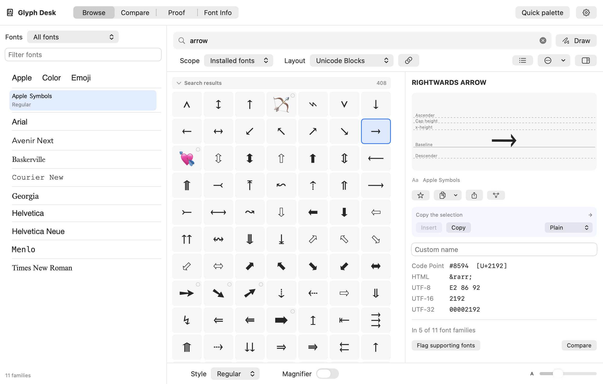
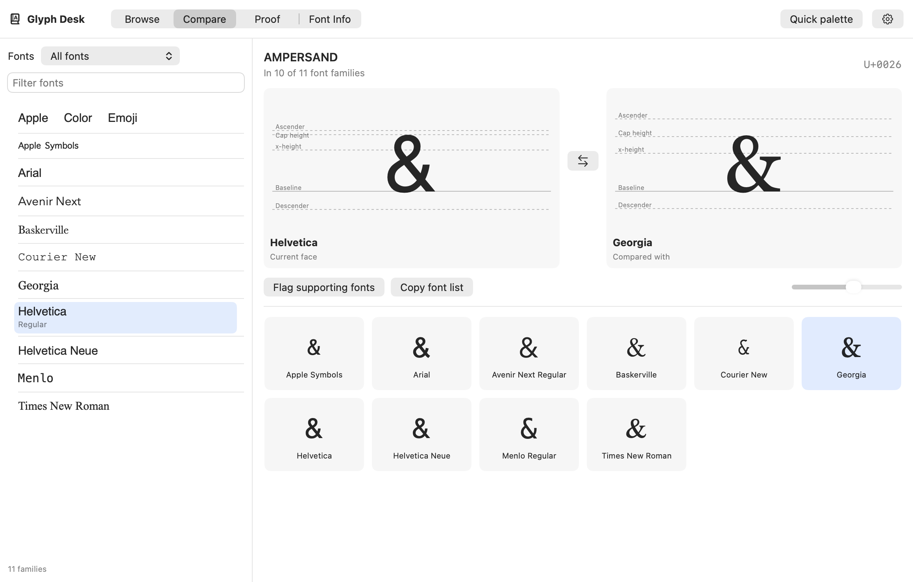
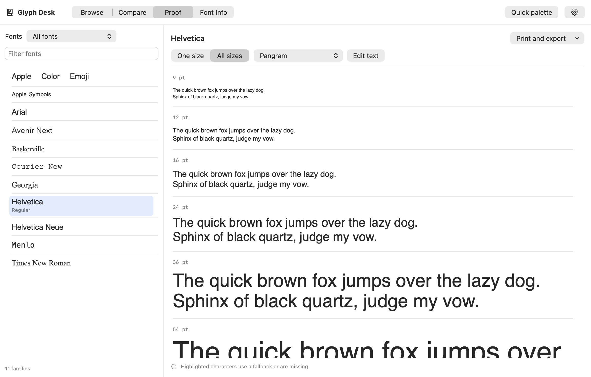

# Glyph Desk

Glyph Desk is a lightweight, open-source alternative to PopChar™ for macOS. It is an independent Near Future Laboratory project for finding the right character, seeing how it looks in the fonts you have, and putting it into the app you’re working in. [PopChar by Ergonis](https://ergonis.com/en/popchar/)

[Download Glyph Desk for macOS](https://github.com/bleeckerj/nfl-glyphdesk/releases/download/v1.0.0/GlyphDesk-macOS-universal.zip) · [Release notes](https://github.com/bleeckerj/nfl-glyphdesk/releases)

## What you can do

- Find symbols and emoji by name, keyword, code point, sketch, or visual similarity. Save frequent characters and give them your own names.
- Browse Unicode blocks, scripts, emoji, custom layouts, or the actual glyphs in an installed font. Inspect a character’s name, encodings, keyboard equivalent, and font coverage.
- Compare a character in two fonts on a shared baseline. Edit a sample proof at one size or several, look up font metadata, and print or save proofs and glyph sheets as PDFs.
- Copy or insert plain or formatted text, HTML references, Swift escapes, decimal and hex codes, names, descriptions, or images. You can also copy a rendered glyph as PNG or PDF.

## Screenshots

### Character browser

### Font comparison

### Text proof

## Getting started

Glyph Desk supports macOS 13 or later. The universal download includes Apple Silicon and Intel binaries.

1. Unzip the download and move GlyphDesk.app to Applications.
2. Open Glyph Desk and click its menu bar icon or press **Control–Option–Space**.
3. Search for a character. Open **Workspace** to browse fonts, inspect details, compare faces, or make a proof.

In **Settings → Activation**, set **Show Glyph Desk in** to **Menu bar**, **Corner button**, or **Both**. With the corner button enabled, choose **Top left** or **Top right** under **Button position**. Right-click either launcher to open Settings, the workspace, or the palette.

Copy is available immediately. To insert directly at the cursor in another app, grant Accessibility access in Glyph Desk’s Settings. On macOS versions with pasteboard privacy controls, allow clipboard access for restoring a previous clipboard after insertion.

## Building from source

Open GlyphDesk.xcodeproj and select the shared **GlyphDesk** scheme. The checked-in project builds the Unicode catalog from bundled inputs. XcodeGen is needed when you change the project specification or add source files.

Run the native tests and build a local universal archive from the repository root.

    xcodebuild -project GlyphDesk.xcodeproj -scheme GlyphDesk -destination 'platform=macOS' -derivedDataPath .build/Derived test
    Scripts/package.sh

The packaging script writes an ad hoc-signed build to Build/GlyphDesk.zip. The CLI can look up characters from Terminal or from the included Typinator script asset.

    /Applications/GlyphDesk.app/Contents/Helpers/glyphdesk lookup --first 'rightwards arrow'
    /Applications/GlyphDesk.app/Contents/Helpers/glyphdesk lookup --json 'flag Canada'

To use the Typinator wrapper, add Scripts/GlyphDesk-Typinator.sh to Typinator’s Assets and pass the query as its script argument.

## License and data

Glyph Desk’s source code is available under the [MIT License](LICENSE). The bundled Unicode 18.0, Emoji 18.0, CLDR 49, Unihan, and WHATWG named character references retain their own terms. See the [third-party notices](Resources/ThirdPartyNotices.txt) and [license texts](Resources/Licenses).

Glyph Desk uses the fonts installed on your Mac.
